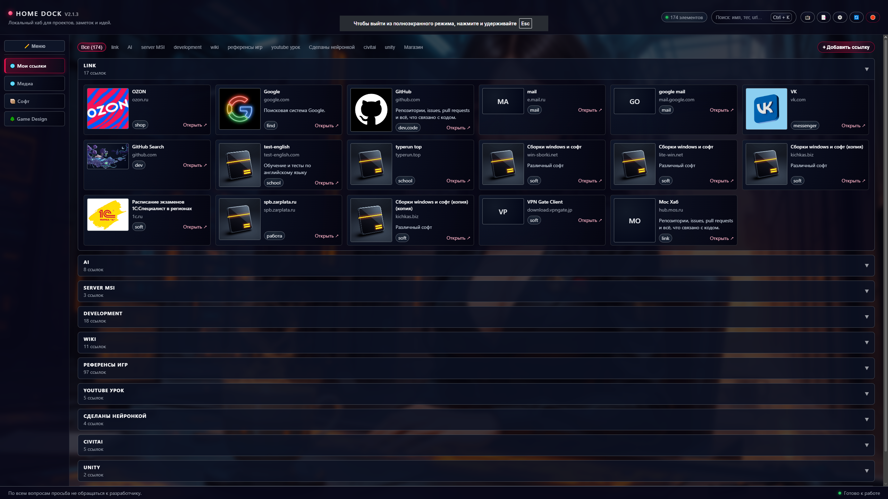
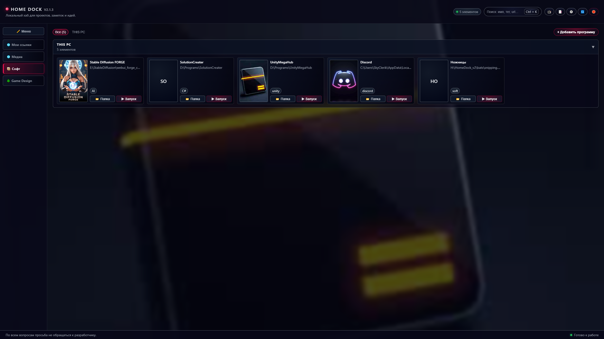

# 🏠 SkyClerik Home DOCK v2

**Локальное стартовое окно, лаунчер программ и персональный хаб для заметок, работающий на чистом Python без сторонних зависимостей.**

Проект разворачивается за пару секунд на любом ПК с Python, хранит все данные в понятных локальных файлах (`JSON` и `Markdown`) и легко переносится между дисками или компьютерами.

---

## 📸 Скриншоты интерфейса

<p align="center">
  
  
  
</p>

## ✨ Основные возможности

* **📑 Модульные вкладки из шаблонов.** Создавайте неограниченное количество вкладок в один клик прямо из интерфейса (поддерживаются архивы `.zip` и `.rar` в папке `templates/`), меняйте их порядок перетаскиванием и настраивайте названия.
* **🔗 Менеджер ссылок.** Удобная группировка закладок по сворачиваемым категориям, быстрый поиск и подгрузка превью для YouTube-видео (с обходом CORS через встроенный прокси).
* **🚀 Лаунчер программ и скриптов.** Запуск `.exe`, `.bat`, `.cmd` и других файлов напрямую из карточек (включая тихий запуск в фоне без окна консоли по флагу `--hidden`) и быстрое открытие рабочих папок в проводнике.
* **🌳 База знаний и Game Design (в стиле HacknPlan).** Древовидная структура заметок с вложенностью, прогресс-барами, тегами, цветовыми маркерами, встроенным Markdown-редактором и **компактным режимом** (`◧`), превращающим дерево в узкую полоску из цветных плиток.
* **🖼️ Живые обои для каждой вкладки.** Положите любые изображения в папку `wallpapers/` внутри конкретной вкладки — при каждом открытии фон будет выбираться случайным образом.
* **🛡️ Автоматическое резервное копирование и корзина.** Ежедневный бэкап всех `data.json` и `settings.json` в папку `backups/`, а также безопасное удаление вкладок в корзину `backups/deleted_tabs/` с автоочисткой через 7 дней.

---

## 🚀 Быстрый старт

### Требования
* Установленный **Python 3.8+** (стандартная библиотека, установка пакетов через `pip` не требуется).
* ОС Windows (для системных диалогов выбора файлов, запуска `.bat`/`.exe` и открытия папок).

### Запуск
1. Скачайте репозиторий или распакуйте релиз в любую удобную папку.
2. Запустите файл **`start.bat`** (или выполните `python src/server.py` из терминала).
3. Сервер автоматически запустится на `http://127.0.0` и откроет стартовую страницу в браузере по умолчанию.

---

## 📁 Структура проекта

```text
HomeDock/
├── src/
│   ├── index.html          # Главный каркас приложения
│   ├── server.py           # Локальный многопоточный HTTP-сервер и API
│   ├── config.py           # Единый файл настроек, путей и метаданных
│   ├── manifest.json       # Паспорт версии проекта для автообновления
│   ├── tabs/               # Рабочие вкладки пользователя (data.json, images/, wallpapers/)
│   ├── templates/          # Архивы шаблонов для создания новых вкладок
│   ├── bats/               # Пользовательские .bat-обертки для запуска софта
│   └── backups/            # Ежедневные резервные копии и корзина удаленных вкладок
├── update.py               # Скрипт безопасного переноса данных при обновлении
├── update.bat              # Запуск обновления в один клик
└── README.md               # Документация проекта
```

---

## 🔄 Как обновиться на новую версию (без потери данных)

В проект встроен безопасный сборщик обновлений, который не перезаписывает вашу старую папку, а собирает готовую новую версию в отдельный каталог:

1. Скачайте архив с новой версией с GitHub и распакуйте его рядом со своей текущей рабочей папкой `HomeDock`.
2. Убедитесь, что рядом со скриптом `update.bat` находятся ровно две папки проекта (ваша старая версия и новая распакованная).
3. Запустите **`update.bat`**.
4. Скрипт автоматически сравнит версии по `manifest.json`, создаст новую папку `HomeDock_Updated_v...`, обновит движок всех вкладок из свежих шаблонов и аккуратно перенесет ваши `data.json`, `settings.json`, картинки, обои, скрипты `bats/` и названия вкладок.

---

## ⌨️ Горячие клавиши и управление

* **`Ctrl + K`** — быстрый поиск по названию, тегам, ссылкам и содержимому заметок.
* **`◧` (в дереве проекта)** — свернуть структуру в компактную вертикальную полоску, освободив место для чтения и копирования Markdown.
* **Кнопки в правом верхнем углу** — YouTube-информер (`📺`), менеджер создания и сортировки вкладок (`📑`), настройки тем (`⚙️`), перезапуск (`🔄`) и остановка сервера (`🛑`).
