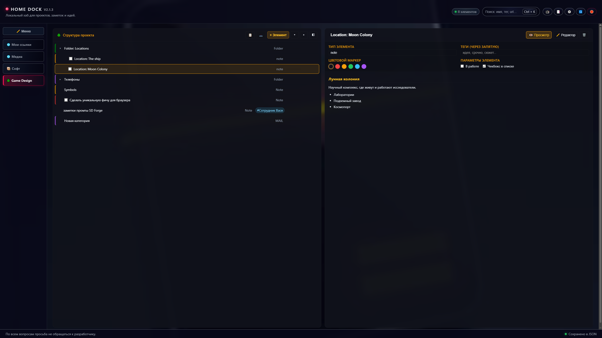
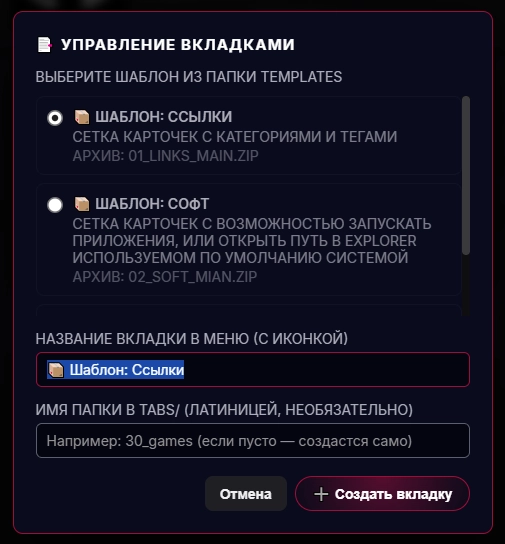
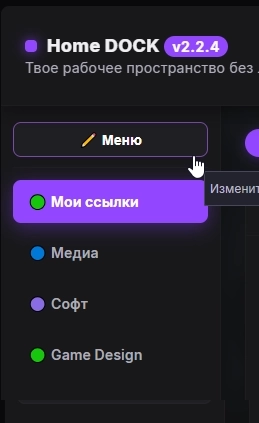
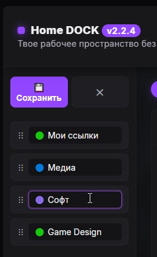

# 🏠 SkyClerik Home DOCK v2

**Локальное стартовое окно, лаунчер программ и персональный хаб для заметок в виде автономного приложения для Windows.**

Проект запускается в один клик из единого исполняемого файла, работает в фоновом режиме в системном трее, хранит все данные в понятных локальных файлах (`JSON` и `Markdown`) и легко переносится между дисками или компьютерами.

---

## 📸 Скриншоты интерфейса

<p align="center">
  
  
  
</p>

---

## ✨ Основные возможности

* **⚡ Полная автономность (Zero Dependencies).** Приложение собрано на современном **.NET 8 (C#)** в один автономный файл `BrowserBridge.exe`. Не требует установки интерпретаторов или фреймворков — работает сразу после скачивания.
* **🖥️ Работа из системного трея и автообновление.** При запуске сервер сворачивается в трей рядом с часами. Клик по иконке открывает панель управления с проверкой свежих релизов на GitHub и автоматическим обновлением в один клик.
* **📑 Модульные вкладки из шаблонов.** Создавайте неограниченное количество вкладок в один клик прямо из интерфейса (поддерживаются архивы `.zip` и `.rar` в папке `templates/`), меняйте их порядок перетаскиванием и настраивайте названия.
* **🔗 Менеджер ссылок.** Удобная группировка закладок по сворачиваемым категориям, быстрый поиск и подгрузка превью для YouTube-видео (с обходом CORS через встроенный прокси).
* **🚀 Лаунчер программ и скриптов.** Запуск `.exe`, `.bat`, `.cmd` и других файлов напрямую из карточек (включая тихий запуск в фоне без окна консоли по флагу `--hidden`) и быстрое открытие рабочих папок в системном файловом менеджере по умолчанию.
* **🌳 База знаний и Game Design (в стиле HacknPlan).** Древовидная структура заметок с вложенностью, прогресс-барами, тегами, цветовыми маркерами, встроенным Markdown-редактором и **компактным режимом** (`◧`), превращающим дерево в узкую полоску из цветных плиток.
* **🖼️ Живые обои для каждой вкладки.** Положите любые изображения в папку `wallpapers/` внутри конкретной вкладки — при каждом открытии фон будет выбираться случайным образом.
* **🛡️ Автоматическое резервное копирование и корзина.** Ежедневный бэкап всех `data.json` и `settings.json` в папку `backups/`, а также безопасное удаление вкладок в корзину `backups/deleted_tabs/` с автоочисткой через 7 дней.

---

## 🚀 Быстрый старт

### Требования
* **ОС Windows 10 / 11 (x64)**.

### Запуск
1. Скачайте репозиторий или распакуйте релиз в любую удобную папку.
2. Запустите **`src/BrowserBridge.exe`**.
3. Приложение свернется в системный трей, поднимет локальный сервер на `http://127.0.0.1:8080` и автоматически откроет стартовую страницу в браузере по умолчанию.
4. Первым делон надо открыть "Управление вкладками" и создать вкладки из доступных шаблонов. Позже можно настроить имена и порядок в "МЕНЮ" вкладок

<p align="center">
  
</p>
<p align="center">
  
</p>

<p align="center">
  
  
</p>

### Настройки сервера
* **В manifest.json хранятся настрофки запуска сервера**. 

---

## 📁 Структура проекта

```text
HomeDock/
├── src/
│   ├── BrowserBridge.exe  # Автономный веб-сервер, трей и модуль автообновления
│   ├── index.html          # Главный каркас приложения
│   ├── manifest.json       # Паспорт версии проекта, ссылки для автообновления, настройки запуска сервера
│   ├── settings.json       # Глобальные настройки интерфейса
│   ├── tabs/               # Рабочие вкладки пользователя (data.json, images/, wallpapers/)
│   ├── templates/          # Архивы шаблонов (.zip / .rar) для создания новых вкладок
│   ├── bats/               # Пользовательские .bat-обертки для запуска софта
│   └── backups/            # Ежедневные резервные копии и корзина (создается автоматически)
├── docs/                   # Скриншоты и материалы для документации
├── resources/              # Иконка для браузера и основные стили web хаба
├── LICENSE                 # Лицензия MIT
└── README.md               # Документация проекта
```

---

## 🔄 Автоматическое обновление (без потери данных)

Больше не нужно вручную скачивать архивы и переносить папки — система обновления встроена прямо в `BrowserBridge.exe`:

1. Нажмите на иконку **Home DOCK** в системном трее возле часов, чтобы открыть окно управления.
2. Если на GitHub вышла новая версия, кнопка обновления загорится **синим** (`Обновить до v...`).
3. Нажмите её — программа сама скачает свежую версию с прогресс-баром, создаст рядом новую папку `HomeDock v...`, обновит движок всех вкладок из свежих шаблонов и аккуратно перенесет ваши `data.json`, `settings.json`, картинки, обои, скрипты `bats/` и названия вкладок.
4. Через 5 секунд сервер автоматически перезапустится в новую папку, а старая версия будет безопасно перемещена в **Корзину Windows**.

*(Поддерживается даже обновление со старых Python-версий `v2.1.0+` — достаточно положить `BrowserBridge.exe` в старую папку и запустить).*

---

## ⌨️ Горячие клавиши и управление

* **`Ctrl + K`** — быстрый поиск по названию, тегам, ссылкам и содержимому заметок.
* **`◧` (в дереве проекта)** — свернуть структуру в компактную вертикальную полоску, освободив место для чтения и копирования Markdown.
* **Кнопки в правом верхнем углу** — YouTube-информер (`📺`), менеджер создания и сортировки вкладок (`📑`), настройки тем (`⚙️`), перезапуск (`🔄`) и остановка сервера (`🛑`).
* **Иконка в системном трее** — открытие окна проверки обновлений, быстрый переход в браузер или полное завершение работы сервера.

---

## 📄 Лицензия

Проект распространяется под лицензией **MIT**. Подробности смотрите в файле [LICENSE](LICENSE).
